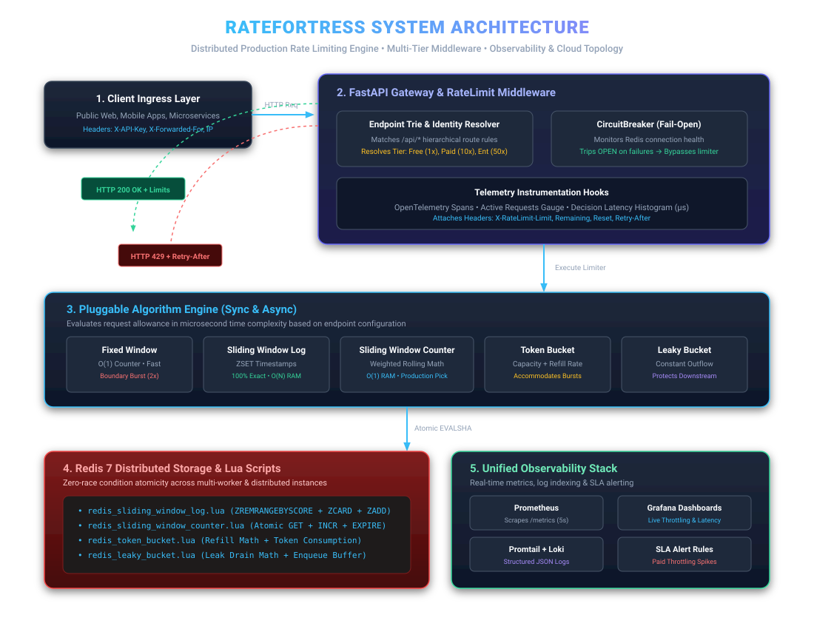

# RateFortress — Distributed Rate Limiting Engine

[](https://github.com/koi-bito/RateFortress/actions/workflows/test.yml)
[](https://opensource.org/licenses/MIT)
[](https://www.python.org/)
[](https://redis.io/)
[](https://www.docker.com/)

I built RateFortress to understand how rate limiting works at the systems level, from basic Python logic up to distributed Redis backends. I wanted to see the race conditions, memory footprints, and latency differences by writing and testing each algorithm myself. It provides rate limiting algorithms with FastAPI middleware, Redis Lua scripts, and observability tools.

---

## 🏛️ System Architecture



---

## 💡 What It Does & Key Capabilities

- I implemented six algorithms from scratch in Python and Redis Lua: Fixed Window Counter, Sliding Window Log, Sliding Window Counter, Token Bucket, Leaky Bucket, and GCRA.
- I wrote atomic Redis Lua scripts for the distributed versions so concurrent requests cannot race between reading and writing counters.
- I exposed the logic through both FastAPI ASGI middleware and a gRPC microservice.
- I added a route trie for prefix matching, API key tiers with multipliers, compound keys combining IP and path, and standard HTTP rate limit headers.
- I built a priority queue with load shedding to drop free traffic early with HTTP 503 when the server gets saturated, protecting paid requests.
- I set up health check endpoints, a circuit breaker that fails open when Redis is down, and signal handling for SIGTERM and SIGINT to drain active requests.
- I created an admin dashboard at /admin to manage keys and a comparison endpoint at /compare to evaluate all algorithms side by side.
- I wired up Prometheus metrics, Loki logging, and OpenTelemetry tracing so I can inspect latency attribution.

---

## 📊 Empirical Benchmarks & Performance Matrix

I benchmarked these implementations against a local Redis instance using benchmarks/run_redis_benchmark.py and a 50-thread concurrent test harness.

| Algorithm Implementation | Storage Backend | Atomicity Model | Throughput (req/s) | 50-Thread Concurrent Stress (Limit=10) | Over-Admission Leak? | Memory Footprint (Per User) |
| :--- | :--- | :--- | :--- | :--- | :--- | :--- |
| Fixed Window Counter | Redis (INCR + EXPIRE) | Redis Atomic INCR | 43,334 req/s | 10 Allowed / 40 Blocked | 0% (Zero) | O(1) (1 counter) |
| Sliding Window Counter | Redis Key-Value (GET + INCR) | Atomic Lua Script | 7,213 req/s | 10 Allowed / 40 Blocked | 0% (Zero) | O(1) (2 counters) |
| GCRA (Cell Rate) | Redis String (GET/SET) | Atomic Lua Script | 6,695 req/s | 10 Allowed / 40 Blocked | 0% (Zero) | O(1) (~32 bytes TAT) |
| Token Bucket | Redis Hash (HMGET/HMSET) | Atomic Lua Script | 6,533 req/s | 10 Allowed / 40 Blocked | 0% (Zero) | O(1) (tokens + time) |
| Leaky Bucket | Redis Hash (HMGET/HMSET) | Atomic Lua Script | 6,310 req/s | 10 Allowed / 40 Blocked | 0% (Zero) | O(1) (queue depth) |
| Sliding Window Log | Redis Sorted Set (ZSET) | Atomic Lua Script | 5,858 req/s | 10 Allowed / 40 Blocked | 0% (Zero) | O(N) (timestamps) |

Full load test, spike, soak, and memory profiling results are in [BENCHMARKS.md](BENCHMARKS.md).

---

## 📁 Repository Structure

```
ratefortress/
├── src/
│   ├── algorithms/     # Core algorithms (Fixed, Sliding Log, Sliding Counter, Token, Leaky, GCRA)
│   ├── middleware/     # FastAPI middleware, EndpointTrie, CircuitBreaker, key management
│   ├── api/            # Gateway routes, admin endpoints, and /compare engine
│   ├── grpc_service/   # gRPC service implementation
│   ├── monitoring/     # Prometheus metrics, JSON logging, OpenTelemetry tracing
│   └── storage/        # Redis connection pools and atomic Lua scripts
├── proto/              # Protocol Buffers definitions
├── templates/          # HTML templates for comparison and admin dashboard
├── tests/              # 211 automated tests covering algorithms, concurrency, and routes
├── benchmarks/         # Benchmark scripts and boundary reproducers
├── loadtests/          # Locust and k6 load testing scripts
├── monitoring/         # Grafana dashboard provisioning, Prometheus, and Promtail configs
├── docs/               # System design notes, runbooks, and architectural docs
├── render.yaml         # Render deployment config
├── railway.json        # Railway deployment config
├── docker-compose.yml  # Local stack orchestration
├── Dockerfile          # Python 3.13 image definition
├── requirements.txt    # Project dependencies
├── LEARNINGS.md        # Daily engineering log
├── BENCHMARKS.md       # Benchmark results and analysis
└── building_plan.md    # Development plan and milestone log
```

---

## 🚦 Status & Milestones

- Current Status: Complete — Days 1 to 143.
- Test Suite Status: 211 automated tests passing.

---

## ⚡ Quickstart

### 1. Run Complete Observability Stack (Docker Compose)

```bash
docker-compose up -d
```
- RateFortress API Gateway: `http://localhost:8000`
- Algorithm Comparison Dashboard: `http://localhost:8000/compare`
- Prometheus Telemetry: `http://localhost:9090`
- Grafana Live Dashboards: `http://localhost:3000` (User: `admin` / Password: `admin`)
- Loki Log Aggregation: `http://localhost:3100`

### 2. Local Python Environment Setup

```bash
# Clone repository
git clone https://github.com/koi-bito/RateFortress.git
cd RateFortress

# Setup virtual environment
python -m venv ratefortress_env
source ratefortress_env/bin/activate  # Windows: ratefortress_env\Scripts\activate

# Install dependencies
pip install -r requirements.txt
```

### 3. Run Automated Test Suite (211 Tests)

```bash
pytest -v
```

### 4. Run Live Algorithm Comparison Engine

```bash
# Start gateway
uvicorn src.api.main:app --port 8000

# JSON API
curl "http://localhost:8000/compare?users=100&requests_per_user=50&window=10&pattern=skewed"

# Web Browser Interactive Dashboard
# Open http://localhost:8000/compare in any browser to view comparative charts and tables.
```

### 5. Run Live Deployment Smoke Test

```bash
python scripts/smoke_test_deployment.py --url http://localhost:8000
```

### 6. Run Zero-Downtime Blue-Green Cutover Simulation

```bash
python scripts/blue_green_deploy.py --requests 100
```

---

## 🎯 What This Project Demonstrates (Resume Bullet Points)

This project shows that I can design and build backend systems from first principles without relying on high-level abstractions. I wrote the core data structures and rate limiters myself, diagnosed and fixed multi-threaded race conditions using Redis Lua scripts, and wired everything into an ASGI gateway with load shedding and circuit breaking. I also set up metrics, tracing, structured logs, and Docker environments, so I know how these pieces behave under real load.

---

## ⚠️ Known Limitations

This implementation is intentionally scoped to a single-region deployment. Multi-datacenter quota synchronization across global regions and production traffic replay datasets were kept out of scope to focus on core rate-limiting algorithms, Redis Lua atomicity, and local gateway latency.

---

## 📜 Documentation Links

- [System Architecture Diagram](docs/architecture.svg)
- [Algorithmic Tradeoffs Matrix](docs/tradeoffs.md)
- [System Design Mock Interview Guide & Defense](docs/interview_prep_and_defense.md)
- [Demo Video Script & Public Launch Walkthrough](docs/demo_script_and_walkthrough.md)
- [Production Cloud Deployment Guide](docs/cloud_deployment_guide.md)
- [Incident Response & Rollback Runbook](docs/runbook.md)
- [Empirical Benchmarks & Concurrency Analysis](BENCHMARKS.md)
- [Daily Engineering Log](LEARNINGS.md)
