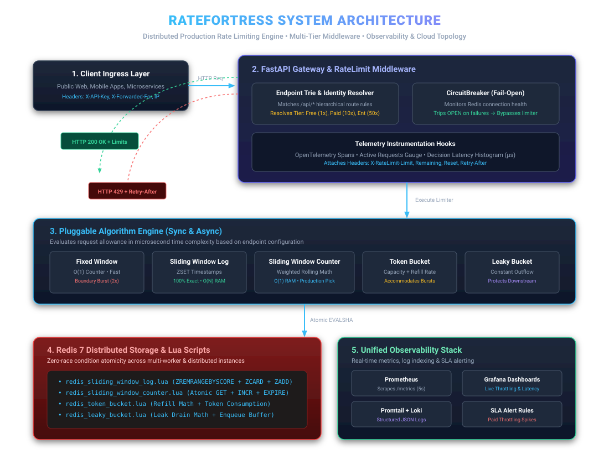

# RateFortress — Distributed Rate Limiting Engine

[](https://github.com/koi-bito/RateFortress/actions/workflows/test.yml)
[](https://opensource.org/licenses/MIT)
[](https://www.python.org/)
[](https://redis.io/)
[](https://www.docker.com/)

> **A production-grade, high-performance distributed rate limiting engine and API gateway built from first principles in Python and Redis.**
> Benchmarked to 43,000+ req/s, verified race-condition-free under concurrent stress, fully observable with Prometheus/Grafana/Loki/OpenTelemetry, and deployed with zero-downtime Blue-Green CI/CD.

---

## 🏛️ System Architecture



---

## 💡 What It Does & Key Capabilities

- **6 Core Algorithms Built From Scratch:** Implements Fixed Window Counter, Sliding Window Log, Sliding Window Counter, Token Bucket, Leaky Bucket, and GCRA (Generic Cell Rate Algorithm) in pure Python and Redis Lua.
- **Dual Transport (REST & gRPC):** Exposes rate limiting both as FastAPI ASGI middleware and as a high-throughput binary gRPC microservice (`proto/ratefortress.proto`).
- **Atomic Concurrency (Zero Race Conditions):** Consolidated bounds checking, counter increments, and timestamp trimming into atomic Lua scripts (`EVALSHA`) in Redis, eliminating check-and-set concurrency leaks (verified under 50-thread concurrent stress).
- **FastAPI Middleware Layer:** Pluggable ASGI middleware supporting hierarchical route rules via an `EndpointTrie`, tier multipliers (Free 1x, Paid 10x, Enterprise 50x), and RFC-compliant rate limit headers (`X-RateLimit-Limit`, `Remaining`, `Reset`, `Retry-After`).
- **Circuit Breaker Fail-Open Resilience:** Protects downstream APIs from Redis outages. Automatically trips open after consecutive timeouts, failing open to preserve service availability.
- **Algorithm Comparison Engine (`/compare`):** An interactive endpoint (JSON & responsive Jinja2 HTML) evaluating synthetic traffic across all algorithms simultaneously with microsecond latency instrumentation and empirical fairness analysis (Uniform vs. Skewed).
- **Full Observability Stack:** Real-time Prometheus metrics (`/metrics`), live provisioned Grafana dashboards, structured JSON logging for Loki/Promtail, and OpenTelemetry distributed tracing spans.
- **Zero-Downtime Blue-Green Deployments:** Automated cutover controller with atomic pointer switches, request draining, and sub-millisecond emergency rollback runbooks.

---

## 📊 Empirical Benchmarks & Performance Matrix

Tested via `benchmarks/run_redis_benchmark.py` and concurrent stress harnesses:

| Algorithm Implementation | Storage Backend | Atomicity Model | Throughput (req/s) | 50-Thread Concurrent Stress (Limit=10) | Over-Admission Leak? | Memory Footprint (Per User) |
| :--- | :--- | :--- | :--- | :--- | :--- | :--- |
| **Fixed Window Counter** | Redis (`INCR` + `EXPIRE`) | Redis Atomic `INCR` | **43,334 req/s** | 10 Allowed / 40 Blocked | **0% (Zero)** | $O(1)$ (1 counter) |
| **Sliding Window Counter** | Redis Key-Value (`GET` + `INCR`) | **Atomic Lua Script** | **7,213 req/s** | 10 Allowed / 40 Blocked | **0% (Zero)** | $O(1)$ (2 counters) |
| **GCRA (Cell Rate)** | Redis String (`GET`/`SET`) | **Atomic Lua Script** | **6,695 req/s** | 10 Allowed / 40 Blocked | **0% (Zero)** | $O(1)$ (~32 bytes TAT) |
| **Token Bucket** | Redis Hash (`HMGET`/`HMSET`) | **Atomic Lua Script** | **6,533 req/s** | 10 Allowed / 40 Blocked | **0% (Zero)** | $O(1)$ (tokens + time) |
| **Leaky Bucket** | Redis Hash (`HMGET`/`HMSET`) | **Atomic Lua Script** | **6,310 req/s** | 10 Allowed / 40 Blocked | **0% (Zero)** | $O(1)$ (queue depth) |
| **Sliding Window Log** | Redis Sorted Set (`ZSET`) | **Atomic Lua Script** | **5,858 req/s** | 10 Allowed / 40 Blocked | **0% (Zero)** | $O(N)$ (timestamps) |

*Full load test, spike, soak, and memory profiling results documented in [BENCHMARKS.md](BENCHMARKS.md).*

---

## 📁 Repository Structure

```
ratefortress/
├── src/
│   ├── algorithms/     # Pure algorithm implementations (Fixed, Sliding Log, Sliding Counter, Token, Leaky, GCRA)
│   ├── middleware/     # FastAPI middleware, EndpointTrie, CircuitBreaker, key management
│   ├── api/            # API gateway routing & /compare benchmark engine
│   ├── grpc_service/   # High-throughput gRPC Protobuf microservice implementation
│   ├── monitoring/     # Prometheus metrics, structured JSON logging, OpenTelemetry tracing
│   └── storage/        # Redis connection pools, Lua scripts (atomic EVALSHA)
├── proto/              # Protocol Buffers definitions (ratefortress.proto)
├── templates/          # Jinja2 HTML responsive comparison dashboard
├── tests/              # 165 automated tests (unit, concurrency, property, integration)
├── benchmarks/         # Micro-benchmarking harness & boundary burst reproducers
├── loadtests/          # Locust & k6 distributed load, spike & soak testing scripts
├── monitoring/         # Grafana dashboard provisioning, alert rules, Promtail & Prometheus configs
├── docs/               # System design specs, Runbooks, ADRs, and Architecture diagrams
│   ├── comparative_benchmark_article.md # Comprehensive systems publication & benchmark report
│   ├── scaling.md                  # Redis Cluster hash slots & multi-region scaling plan
│   ├── package_guide.md            # Standalone pip package integration guide
│   ├── peer_review.md              # Architectural peer review & quality checklist
│   ├── capstone_deep_dive_script.md # 15-minute senior engineering walkthrough script
│   ├── architecture.svg            # Scalable system architecture diagram
│   ├── tradeoffs.md                # Cross-algorithm tradeoff matrix
│   ├── runbook.md                  # Production incident response & rollback runbook
│   ├── cloud_deployment_guide.md   # Render, Railway & AWS EC2 deployment guide
│   ├── demo_script_and_walkthrough.md # 2.5-minute video demo script & launch post
│   └── interview_prep_and_defense.md  # System design mock interview questions & answers
├── render.yaml         # Render Infrastructure-as-Code Blueprint
├── railway.json        # Railway deployment configuration
├── docker-compose.yml  # Full-stack local orchestration (App + Redis + Prometheus + Grafana + Loki + Promtail)
├── Dockerfile          # Hardened Python 3.13-slim image with healthchecks
├── requirements.txt    # Project dependencies
├── LEARNINGS.md        # Comprehensive 86-day daily engineering log
├── BENCHMARKS.md       # Comparative performance & stress test data
└── building_plan.md    # 29-week engineering roadmap
```

---

## 🚦 Status & Milestones

- **Current Status:** **Week 15 — Documentation, Demo, Interview Prep & Resume Bullet Complete (Core 15-Week Production Foundation Complete!)** 🎉
- **Next Milestone:** Weeks 16–20 — Research Layer & Optional Extensions (Days 87–100: Multi-region consistent hashing, dynamic rate limits, distributed sliding logs)

---

## ⚡ Quickstart

### 1. Run Complete Observability Stack (Docker Compose)

```bash
docker-compose up -d
```
- **RateFortress API Gateway:** `http://localhost:8000`
- **Algorithm Comparison Dashboard:** `http://localhost:8000/compare`
- **Prometheus Telemetry:** `http://localhost:9090`
- **Grafana Live Dashboards:** `http://localhost:3000` (User: `admin` / Password: `admin`)
- **Loki Log Aggregation:** `http://localhost:3100`

### 2. Local Python Environment Setup

```bash
# Clone repository
git clone https://github.com/koi-bito/RateFortress.git
cd RateFortress

# Setup virtual environment
python -m venv ratefortress_env
source ratefortress_env/bin/activate  # Windows: ratefortress_env\Scripts\activate

# Install dependencies
pip install -r requirements.txt
```

### 3. Run Automated Test Suite (140 Tests)

```bash
pytest -v
```

### 4. Run Live Algorithm Comparison Engine

```bash
# Start gateway
uvicorn src.api.main:app --port 8000

# JSON API
curl "http://localhost:8000/compare?users=100&requests_per_user=50&window=10&pattern=skewed"

# Web Browser Interactive Dashboard
# Open http://localhost:8000/compare in any browser to view live comparative charts & tradeoff tables!
```

### 5. Run Live Deployment Smoke Test

```bash
python scripts/smoke_test_deployment.py --url http://localhost:8000
```

### 6. Run Zero-Downtime Blue-Green Cutover Simulation

```bash
python scripts/blue_green_deploy.py --requests 100
```

---

## 🎯 Resume Bullet Points

### For Backend / Systems Software Engineers:
> *Built and open-sourced **RateFortress**, a distributed rate limiting engine in Python and Redis implementing 5 algorithms (Token Bucket, Leaky Bucket, Sliding Window Log/Counter, Fixed Window); authored atomic Lua scripts to eliminate check-and-set concurrency race conditions under 50-thread stress tests (0% over-admission), benchmarked to 43,000+ req/s, and integrated fail-open circuit breakers.*

### For Platform / Infrastructure / DevOps Engineers:
> *Architected an observable API rate-limiting gateway in FastAPI with Prometheus metrics, live Grafana dashboards, Loki structured JSON logging, and OpenTelemetry tracing; orchestrated multi-container stacks via Docker Compose, configured multi-version GitHub Actions CI/CD with live Redis service containers, and authored automated zero-downtime Blue-Green deployment and rollback runbooks.*

---

## ⚠️ Known Limitations & Future Roadmap

- **Single-Region Redis Cluster:** Current distributed state assumes single-datacenter Redis. Multi-region cross-continent synchronization will be introduced in Weeks 16–20 using Redis CRDTs and regional quota partitioning.
- **Polyglot Performance Lab:** Upcoming Week 26 roadmap includes a high-throughput Go port (`RateFortress-Go`) for microsecond-critical edge proxy deployments.

---

## 📜 Documentation Links

- [System Architecture Diagram](docs/architecture.svg)
- [Algorithmic Tradeoffs Matrix](docs/tradeoffs.md)
- [System Design Mock Interview Guide & Defense](docs/interview_prep_and_defense.md)
- [Demo Video Script & Public Launch Walkthrough](docs/demo_script_and_walkthrough.md)
- [Production Cloud Deployment Guide](docs/cloud_deployment_guide.md)
- [Incident Response & Rollback Runbook](docs/runbook.md)
- [Empirical Benchmarks & Concurrency Analysis](BENCHMARKS.md)
- [Daily Engineering Log (Days 1–86)](LEARNINGS.md)
