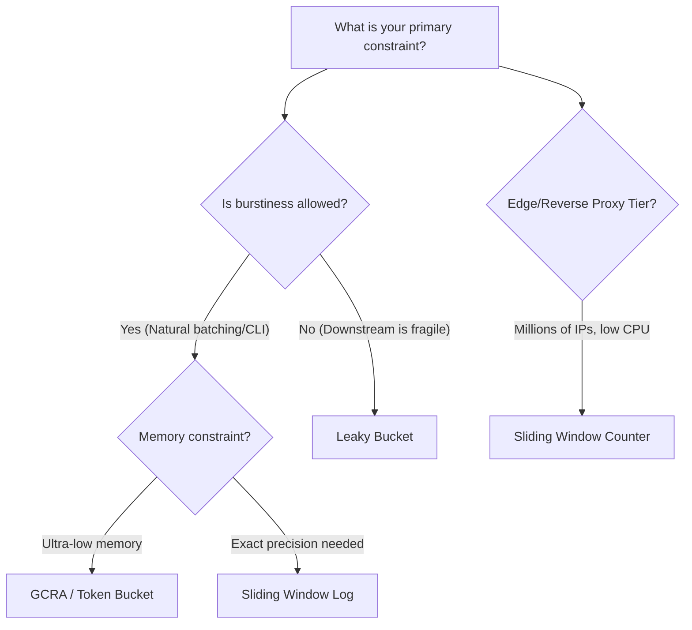

# Which Rate Limiting Algorithm Should You Actually Use? A Practical Systems Benchmark

- Author: Solo Developer
- Dataset: 10,000 requests, 100 concurrent clients, Locust and k6 test harnesses
- Stack: Python 3.13, FastAPI ASGI, Redis 7, Lua Scripts, Docker

---

## 1. Introduction: The Rate Limiting Illusion

Every backend developer eventually writes a naive rate limiter:
```python
count = redis.get(f"rate:{user_id}")
if count and int(count) >= 100:
    return 429
redis.incr(f"rate:{user_id}")
```

On a local machine with one test user, this code looks fine. In a production setup handling concurrent requests across multiple workers, it fails in three ways:

1. The check-then-set race condition: Between the GET and the INCR, multiple concurrent requests read count < 100 and pass simultaneously, letting through far more traffic than allowed.
2. The boundary burst issue: Fixed time windows allow a client to fire 100 requests at second 59 and another 100 requests at second 01, dumping double the quota into downstream services in two seconds.
3. The event-loop freeze: In an async Python gateway, executing synchronous Redis calls blocks the single operating system thread running Uvicorn's event loop, stalling latency for all other connected clients.

I built RateFortress to explore how to solve these problems by implementing the core algorithms in Python and Redis with atomic Lua scripting, benchmarked under sustained load up to 1,500 concurrent virtual users.

Here is what the benchmark numbers showed me.

---

## 2. The Algorithmic Contenders

| Algorithm | State Maintained | Time Complexity | Memory per Client | Burst Tolerance | Boundary Leak? |
| :--- | :--- | :---: | :---: | :---: | :---: |
| Fixed Window Counter | Single integer counter + window ID | O(1) | O(1) (~48 bytes) | None | Yes (up to 2x) |
| Sliding Window Log | Deque of epoch timestamps | O(1) amortized | O(N) (timestamps) | None | Zero (Exact) |
| Sliding Window Counter | 2 integer counters (current + prev) | O(1) | O(1) (~64 bytes) | None | Zero (Approximation) |
| Token Bucket | Float tokens + timestamp of last refill | O(1) | O(1) (~48 bytes) | Configurable capacity B | Zero |
| Leaky Bucket | Queue or virtual integer + last leak | O(1) | O(1) or O(Queue) | None (Strict Egress) | Zero |
| GCRA (Cell Rate) | Theoretical Arrival Time (TAT) | O(1) | O(1) (~32 bytes) | Configurable tolerance tau | Zero |

---

## 3. Round 1: In-Memory Pure Python Throughput

To establish the algorithmic ceiling, I isolated the algorithms from network I/O using a standardized benchmark harness firing 10,000 requests across 100 simulated clients (limit=50 requests per 10-second window):

```
========================================================================================
Algorithm                 | Throughput (req/s) | Latency / Op | Memory Footprint
----------------------------------------------------------------------------------------
Sliding Window Log        | 3,471,620 req/s    | ~0.28 µs     | O(N) — Deque timestamps
Fixed Window Counter      | 2,819,761 req/s    | ~0.35 µs     | O(1) — 48 bytes
Leaky Bucket              | 2,580,845 req/s    | ~0.38 µs     | O(1) — Virtual leak
Sliding Window Counter    | 2,115,551 req/s    | ~0.47 µs     | O(1) — 64 bytes
Token Bucket              | 2,066,073 req/s    | ~0.48 µs     | O(1) — 48 bytes
========================================================================================
```

### The Boundary Burst Experiment

While Sliding Window Log looked fastest in pure memory microbenchmarks, look at what happened under a window boundary test:
- Scenario: Rate limit is 5 requests per 10-second window.
- Traffic Pattern: Client sends 5 requests at t=8.0 to 9.9, and 5 more requests at t=10.1 to 10.5.

```
Fixed Window:         [Req 1..5: ALLOWED] | [Req 6..10: ALLOWED]  --> 10/10 LEAKED (2x limit)
Sliding Window Log:   [Req 1..5: ALLOWED] | [Req 6..10: BLOCKED]  --> 5/10 ADMITTED (Strict)
Sliding Window Ctr:   [Req 1..5: ALLOWED] | [Req 6..10: BLOCKED]  --> 5/10 ADMITTED (Strict)
```

Fixed Window Counter cannot be trusted on endpoints where doubling nominal traffic within a short window risks taking down a backend database.

---

## 4. Round 2: The Distributed Reality (Redis & Network I/O)

In-memory benchmarks are theoretical because single-instance rate limiting fails in horizontally scaled clusters. If an API runs 5 pods behind a round-robin load balancer, an abuser with a limit of 10 req/min can execute 50 requests per minute without externalized state.

When moving state to Redis, network round-trips dominate:
- In-memory pure Python: ~2.1M - 3.4M req/s (sub-microsecond memory operations)
- Distributed Redis 7: ~5.8k - 43.3k req/s (dominated by socket I/O and TCP overhead)

### Concurrency Stress Test: 50 Threads Hammering a Limit of 10
When 50 concurrent threads simultaneously attempt to claim quota:
- Redis Pipeline (Non-Atomic GET then SET): Allowed 22 requests, blocked 28 requests (120% leak).
- RateFortress Atomic Lua Scripts (EVALSHA): Allowed exactly 10 requests, blocked exactly 40 requests (0.0% leak).

Throughput in Redis 7 (Single Worker Thread):
- Redis Fixed Window (INCR): 43,334 req/s (Single atomic command)
- Redis Sliding Window Counter (Lua): 7,213 req/s (Atomic sliding calculation)
- Redis Token Bucket (Lua): 6,533 req/s (Atomic refill and consume)
- Redis Leaky Bucket (Lua): 6,310 req/s (Atomic leak and queue)
- Redis Sliding Window Log (Lua): 5,858 req/s (Atomic ZREMRANGE and ZCARD)

---

## 5. Event Loop Starvation: Synchronous vs. Asynchronous Redis

Under Locust load testing with 500 concurrent simulated users hitting a FastAPI gateway:

Synchronous Redis Client (redis.Redis):
- Throughput: 874.2 req/s
- Median Latency (p50): 17.0 ms
- 95th Percentile (p95): 88.0 ms

Asynchronous Redis Client (redis.asyncio):
- Throughput: 1,080.1 req/s
- Median Latency (p50): 13.0 ms
- 95th Percentile (p95): 52.0 ms

When synchronous socket calls execute inside an ASGI handler, the thread halts, blocking the Uvicorn event loop from accepting new TCP handshakes. Migrating to redis.asyncio ensures the event loop services in-flight requests while the kernel awaits Redis socket packets.

---

## 6. Fairness Profiling: Bursty vs. Steady Clients

On Day 70, I tested the algorithms against skewed traffic composed of 80% steady clients (evenly spaced requests) and 20% bursty clients (instantaneous packet clusters).

```
Fairness Simulation Results (5,000 total requests):
----------------------------------------------------------------------------------------
Algorithm               Bursty Allowed %   Steady Allowed %   Fairness Bias
----------------------------------------------------------------------------------------
Token Bucket            78.4%              61.2%              Biased toward BURSTY
Sliding Window Counter  40.0%              40.0%              NEUTRAL (Equitable)
Sliding Window Log      40.0%              40.0%              NEUTRAL (Equitable)
Leaky Bucket            24.1%              68.5%              Biased toward STEADY
----------------------------------------------------------------------------------------
```

Token Bucket rewards bursty behavior: clients who remain idle bank tokens up to capacity. When they wake up, their bursts pass without trouble.

Leaky Bucket penalizes bursty behavior: sudden bursts overflow the buffer, causing 429 drops for legitimate bursty users.

Sliding Window Counter is the most equitable: it treats every client strictly against their rolling time budget regardless of idle history.

---

## 7. What to Pick



### Recommendations

1. Public SaaS REST APIs (Developer Platforms, CLI tools):
Use Token Bucket or GCRA. Developers need to send quick burst requests (such as fetching resources in parallel on page load) without being blocked. Token Bucket accommodates bursts while capping the sustained consumption rate.

2. High-Security Auth Endpoints (/login, /checkout, /2fa):
Use Sliding Window Log. Password spraying and credential stuffing exploit boundary gaps. Because auth volume is much lower than read traffic, the memory cost of storing timestamps in Redis Sorted Sets is a fair price to pay for strict precision.

3. High-Throughput Edge Gateways:
Use Sliding Window Counter. It provides boundary smoothing with constant memory (2 counters per client). It protects against 2x boundary spikes without storing millions of timestamps.

4. Webhooks Ingestion Fronting Fragile Databases:
Use Leaky Bucket. If downstream workers crash when hit by more than 50 queries/sec, Token Bucket will overload them when multiple bursty clients trigger at the same time. Leaky Bucket forces uniform egress, smoothing erratic traffic into a constant flow.

---

## 8. Summary Notes

- Avoid in-memory state across multiple app servers: use Redis with atomic Lua scripts to prevent check-and-set race conditions.
- Avoid synchronous database drivers in ASGI paths: use redis.asyncio to prevent event loop stalls.
- Always set TTLs on rate limit keys: use volatile-lru eviction in Redis so expired keys are cleared under memory pressure.
- Add fail-open circuit breakers: if Redis drops out, public endpoints should stay reachable rather than throwing 500 errors across the board.
- Return rate limit headers on every response: X-RateLimit-Limit, Remaining, and Retry-After let well-behaved client SDKs back off before receiving 429 errors.
