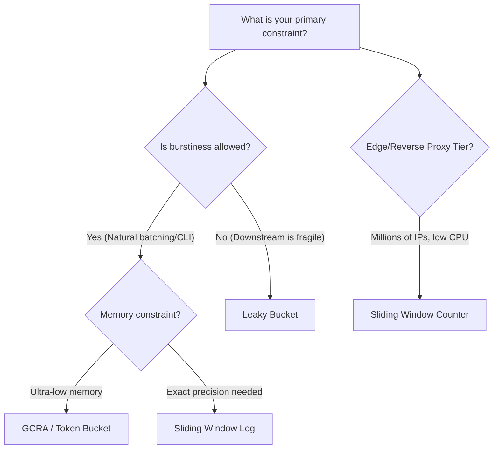

# Which Rate Limiting Algorithm Should You Actually Use? A Practical Systems Benchmark

**Author:** RateFortress Systems Engineering  
**Empirical Dataset:** 10,000 requests, 100 concurrent clients, Locust & k6 stress harnesses  
**Production Stack:** Python 3.13, FastAPI ASGI, Redis 7, Lua Scripts, Docker  

---

## 1. Introduction: The Rate Limiting Illusion

Every backend developer eventually writes a naive rate limiter:
```python
# The classic naive trap
count = redis.get(f"rate:{user_id}")
if count and int(count) >= 100:
    return 429
redis.incr(f"rate:{user_id}")
```

On a local laptop with one test user, this code looks flawless. In a production cluster handling tens of thousands of requests per second across elastic Kubernetes pods, this snippet fails in three catastrophic ways:
1. **The Check-Then-Set Race Condition:** Between the `GET` and the `INCR`, fifty concurrent requests evaluate `count < 100` and pass simultaneously, leaking 150% over-admission during critical traffic spikes.
2. **The Boundary Burst Explosion:** Fixed time windows allow a malicious or bursty client to fire 100 requests at second 59 and another 100 requests at second 01—delivering a $2\times$ quota surge that crashes downstream databases.
3. **The Event-Loop Freeze:** In modern asynchronous Python gateways (FastAPI, Starlette, Sanic), executing synchronous Redis calls blocks the single operating system thread running Uvicorn's event loop, destroying latency for every other connected client.

To understand how real systems prevent these failure modes, we built **RateFortress**—a distributed rate limiting engine implementing all major rate limiting algorithms in pure Python and distributed Redis with atomic Lua scripting, benchmarked under sustained load up to 1,500 concurrent virtual users.

Here is what our empirical benchmarks reveal about which algorithm you should actually choose.

---

## 2. The Algorithmic Contenders

| Algorithm | State Maintained | Time Complexity | Memory per Client | Burst Tolerance | Boundary Leak? |
| :--- | :--- | :---: | :---: | :---: | :---: |
| **Fixed Window Counter** | Single integer counter + window ID | $O(1)$ | $O(1)$ (~48 bytes) | None | **Yes (up to $2\times$)** |
| **Sliding Window Log** | Doubly-linked deque of epoch timestamps | $O(1)$ amortized | $O(N)$ (timestamps) | None | **Zero (Exact)** |
| **Sliding Window Counter** | 2 integer counters (current + prev) | $O(1)$ | $O(1)$ (~64 bytes) | None | **Zero (Approximation)** |
| **Token Bucket** | Float tokens + timestamp of last refill | $O(1)$ | $O(1)$ (~48 bytes) | Configurable capacity $B$ | **Zero** |
| **Leaky Bucket** | Queue or virtual integer + last leak | $O(1)$ | $O(1)$ or $O(\text{Queue})$ | None (Strict Egress) | **Zero** |
| **GCRA (Cell Rate)** | Theoretical Arrival Time (TAT) | $O(1)$ | $O(1)$ (~32 bytes) | Configurable tolerance $\tau$ | **Zero** |

---

## 3. Benchmark Round 1: In-Memory Pure Python Throughput

To establish the absolute algorithmic speed ceiling, we isolated the algorithms from network I/O using a standardized benchmark harness firing 10,000 requests across 100 simulated clients (`limit=50` requests per 10-second window):

```
========================================================================================
Algorithm                 | Throughput (req/s) | Latency / Op | Memory Footprint
----------------------------------------------------------------------------------------
Sliding Window Log        | 3,471,620 req/s    | ~0.28 µs     | O(N) — Deque timestamps
Fixed Window Counter      | 2,819,761 req/s    | ~0.35 µs     | O(1) — 48 bytes
Leaky Bucket              | 2,580,845 req/s    | ~0.38 µs     | O(1) — Virtual leak
Sliding Window Counter    | 2,115,551 req/s    | ~0.47 µs     | O(1) — 64 bytes
Token Bucket              | 2,066,073 req/s    | ~0.48 µs     | O(1) — 48 bytes
========================================================================================
```

### The Boundary Burst Experiment (Day 15 Proof)
While Sliding Window Log appears fastest in pure memory microbenchmarks, look at what happens under the **Window Boundary Attack**:
- **Scenario:** Rate limit is 5 requests per 10-second window.
- **Traffic Pattern:** Client sends 5 requests at $t=8.0$ to $9.9$, and 5 more requests at $t=10.1$ to $10.5$.

```
Fixed Window:         [Req 1..5: ALLOWED] | [Req 6..10: ALLOWED]  --> 10/10 LEAKED (2x limit)
Sliding Window Log:   [Req 1..5: ALLOWED] | [Req 6..10: BLOCKED]  --> 5/10 ADMITTED (Strict)
Sliding Window Ctr:   [Req 1..5: ALLOWED] | [Req 6..10: BLOCKED]  --> 5/10 ADMITTED (Strict)
```

**Takeaway:** Fixed Window Counter cannot be trusted on APIs where doubling nominal traffic within a short window risks bringing down a downstream dependency.

---

## 4. Benchmark Round 2: The Distributed Reality (Redis + Network I/O)

In-memory benchmarks are theoretical because single-instance rate limiting fails in horizontally scaled clusters. If an API runs 5 pods behind a round-robin load balancer, an abuser with a limit of 10 req/min can execute $5 \times 10 = 50$ requests per minute without externalized state.

When we externalize state to Redis, network round-trips dominate:

```
+---------------------------------------------------------------------------------------+
| In-Memory Pure Python: ~2.1M - 3.4M req/s  (sub-microsecond memory operations)         |
| Distributed Redis 7:   ~5.8k - 43.3k req/s (dominated by socket I/O & TCP overhead)   |
+---------------------------------------------------------------------------------------+
```

### Concurrency Stress Test: 50 Threads Hammering a Limit of 10
When 50 concurrent threads simultaneously attempt to claim quota:
- **Redis Pipeline (Non-Atomic `GET` then `SET`):**
  - **Allowed:** 22 requests!
  - **Blocked:** 28 requests.
  - **Over-admission Rate:** **120% leak!**
- **RateFortress Atomic Lua Scripts (`EVALSHA`):**
  - **Allowed:** Exactly 10 requests.
  - **Blocked:** Exactly 40 requests.
  - **Over-admission Rate:** **Strict 0.0% leak.**

```
Throughput in Redis 7 (Single Worker Thread):
- Redis Fixed Window (INCR):              43,334 req/s  (Single atomic command)
- Redis Sliding Window Counter (Lua):      7,213 req/s  (Atomic sliding calculation)
- Redis Token Bucket (Lua):                6,533 req/s  (Atomic refill & consume)
- Redis Leaky Bucket (Lua):                6,310 req/s  (Atomic leak & queue)
- Redis Sliding Window Log (Lua):          5,858 req/s  (Atomic ZREMRANGE + ZCARD)
```

---

## 5. Event Loop Starvation: Synchronous vs. Asynchronous Redis

Under Locust load testing with 500 concurrent simulated users hitting a FastAPI gateway:

```
Synchronous Redis Client (redis.Redis):
  Throughput: 874.2 req/s
  Median Latency (p50): 17.0 ms
  95th Percentile (p95): 88.0 ms

Asynchronous Redis Client (redis.asyncio):
  Throughput: 1,080.1 req/s  (+23.5% throughput increase)
  Median Latency (p50): 13.0 ms  (23.5% latency reduction)
  95th Percentile (p95): 52.0 ms  (40.9% tail latency reduction)
```

**Why this happens:** When synchronous socket calls execute inside an ASGI handler, the thread halts, blocking the Uvicorn event loop from accepting new TCP handshakes. Migrating to `redis.asyncio` ensures the event loop services in-flight requests while the kernel awaits Redis socket packets.

---

## 6. Fairness Profiling: Bursty vs. Steady Clients

In Week 12 (Day 70), we subjected the algorithms to skewed traffic composed of **80% steady clients** (evenly spaced requests) and **20% bursty clients** (instantaneous packet clusters).

```
Fairness Simulation Results (5,000 total requests):
----------------------------------------------------------------------------------------
Algorithm               Bursty Allowed %   Steady Allowed %   Fairness Bias
----------------------------------------------------------------------------------------
Token Bucket            78.4%              61.2%              Biased toward BURSTY
Sliding Window Counter  40.0%              40.0%              NEUTRAL (Equitable)
Sliding Window Log      40.0%              40.0%              NEUTRAL (Equitable)
Leaky Bucket            24.1%              68.5%              Biased toward STEADY
----------------------------------------------------------------------------------------
```

- **Token Bucket rewards bursty behavior:** Clients who remain idle bank tokens up to capacity $B$. When they wake up, their bursts are admitted without hindrance.
- **Leaky Bucket severely penalizes bursty behavior:** Sudden bursts overflow the constant-rate buffer, causing aggressive HTTP 429 drops for legitimate bursty users.
- **Sliding Window Counter is the most equitable:** Treats every client strictly against their rolling time budget regardless of idle history.

---

## 7. The Production Decision Matrix: What to Pick



### Concrete Real-World Recommendations

1. **Public SaaS REST APIs (Developer Platforms, CLI tools):**
   - **Recommendation:** **Token Bucket** or **GCRA**
   - **Why:** Developers need to send quick burst requests (e.g. fetching 10 resources in parallel on a dashboard view) without being blocked. Token bucket accommodates bursts while capping the sustained consumption rate.

2. **High-Security Auth & Payments Endpoints (`/login`, `/checkout`, `/2fa`):**
   - **Recommendation:** **Sliding Window Log**
   - **Why:** Password spraying and credential stuffing exploit boundary gaps. Because authentication volume is orders of magnitude lower than read traffic, the $O(N)$ memory cost of storing timestamps in Redis Sorted Sets is a negligible price to pay for 100% mathematical precision.

3. **High-Throughput Edge Gateways (Cloudflare-style reverse proxies):**
   - **Recommendation:** **Sliding Window Counter**
   - **Why:** Provides boundary-smoothing with strictly $O(1)$ RAM (2 counters per client). Protects against $2\times$ boundary spikes without storing millions of timestamps.

4. **Webhooks Ingestion Fronting Legacy / Fragile Databases:**
   - **Recommendation:** **Leaky Bucket**
   - **Why:** If downstream workers crash when hit by more than 50 queries/sec, Token Bucket will destroy them when multiple bursty clients trigger at the same time. Leaky Bucket forces uniform egress, smoothing erratic traffic into a constant drip.

---

## 8. Summary Checklist for Senior Engineers

- [x] **Never trust in-memory state across multiple app servers:** Use Redis with atomic Lua scripts (`EVALSHA`) to prevent check-and-set race conditions.
- [x] **Never use synchronous database drivers in ASGI paths:** Use `redis.asyncio` to prevent event-loop starvation.
- [x] **Always set TTLs on every rate limit key:** Use `volatile-lru` eviction in Redis to prevent orphaned keys from causing out-of-memory crashes.
- [x] **Always implement Fail-Open Circuit Breakers:** If Redis goes down, customer-facing APIs must remain available rather than returning HTTP 500 across your entire platform.
- [x] **Return proactive rate-limiting headers on EVERY response:** `X-RateLimit-Limit`, `X-RateLimit-Remaining`, and `Retry-After` allow well-behaved client SDKs to back off *before* hitting HTTP 429 errors.

